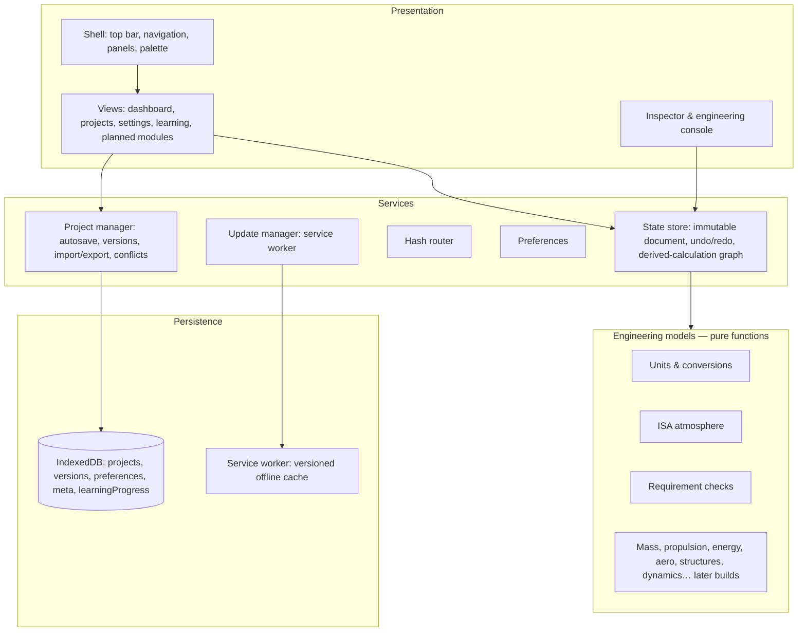

# AEROLAB X — Architecture

Status: **Build 1 (Foundation)** · application version 0.1.0 · last updated 2026-11-21

This document is the architecture proposal requested by the master development prompt (§28): it records the repository inspection, the final architecture, the libraries, the simulation and AI approach, the build plan, the risks and the Build 1 acceptance criteria. It is a living document; every build updates it.

---

## 1. Repository inspection (start of Build 1)

| Item | Finding (2026-11-21) |
|---|---|
| Repository | `batraamul/Drone_Design` exists, public |
| Contents | **Empty** — no files, branches, commits, workflows, Pages site or environments |
| Code to preserve | None |
| Consequence | Build 1 starts from a clean repository. Initial commit goes to `main`; later substantial modules use feature branches with pull requests |

## 2. Principles

1. **Engineering correctness before features.** Every model is documented (equations, assumptions, validity range, references) and unit-tested against reference data.
2. **Transparent fidelity.** Every value carries a provenance label (requirement, user input, assumption, illustrative, datasheet, conceptual estimate, analytical, simulation, measured, validated). Preliminary estimates are never presented as certified analysis, CFD, FEA, flight approval or regulatory authorisation. There is no "flight-ready" state.
3. **One project model.** All modules read and write the same project document; dependent results recompute automatically.
4. **Local-first and private.** Data stays in the browser (IndexedDB) unless the user exports it. No external services or AI APIs are needed.
5. **Data preservation.** Application updates never delete user data; risky operations snapshot first; concurrent edits are detected, not silently overwritten.
6. **Civilian scope.** No weapon, targeting, weapon-release, autonomous-attack or harmful-payload functions. AI and autonomy remain inside the simulation and are never connected to physical flight controls.
7. **Honest UI.** No non-functional buttons, no fake data presented as real, no placeholder module presented as complete. Planned modules say so.

## 3. System overview



**Layer rules** (enforced by structure and tests):

- `js/engineering/**` contains pure functions with no DOM or storage access; they run unchanged in Node tests and, later, in Web Workers.
- Views never touch IndexedDB; all persistence goes through `ProjectManager` / `Database`.
- All text from users or imported files is rendered with `textContent`; HTML-injection sinks (`innerHTML`, `insertAdjacentHTML`, `eval`) are banned by `scripts/check-structure.mjs`.
- Only `js/utils/logger.js` writes to the browser console.

## 4. Technology and libraries

| Concern | Choice | Status | Justification |
|---|---|---|---|
| Language/runtime | HTML5, CSS3, ES2022 modules, **no bundler** | Build 1 | Deploys to GitHub Pages as-is; readable source; matches the required repository layout; nothing to build to run locally |
| Persistence | IndexedDB via a small in-house wrapper (`js/database.js`) | Build 1 | Native, transactional, large quota; no dependency needed |
| Offline/PWA | Service worker + web app manifest | Build 1 | Installable, works offline, controlled update flow |
| Routing | Hash routes (`#/module/...`) | Build 1 | Works on project sub-paths and local copies without server rewrites |
| Plots | In-house SVG line charts (`js/visualisation/plots.js`) | Build 1 | Enough for static engineering profiles; accessible |
| Interactive graphs | Chart.js 4 (MIT), vendored and pinned | Build 4 | Thrust/current/efficiency curves, polars, budgets |
| High-rate telemetry plots | uPlot (MIT) *or* Chart.js decimation — chosen by benchmark | Build 6 | Simulation traces at 100–1000 samples/s |
| 3D | Three.js (MIT), vendored ES-module build, pinned | Build 2 | Interactive aircraft model; 2D SVG fallback when WebGL is unavailable |
| Heavy computation | Web Workers | Build 6 | Keeps UI responsive during simulation, optimisation and AI |
| AI inference | ONNX Runtime Web (MIT): WebAssembly and WebGPU execution providers | Build 8 | Runs exported models locally; no proprietary API |
| Optional training service | Local Python/PyTorch service on `localhost`, documented REST API, opt-in | Build 9 | For demanding training; core app stays useful without it |
| Maps | Optional provider configured by the user (e.g. Leaflet, BSD-2); simulated terrain otherwise | Build 7 | No mandatory third-party service |
| Reports | Printable HTML + browser "Save as PDF"; CSV and JSON exports | Build 11 | No heavy PDF dependency unless print CSS proves insufficient |
| Unit/integration tests | Node built-in test runner; `fake-indexeddb` (Apache-2.0) | Build 1 | Fast, dependency-light; IndexedDB logic tested in Node |
| Browser tests | Playwright (Apache-2.0), Chromium | Build 1 | Real-browser acceptance tests, offline and mobile emulation |
| CI/CD | GitHub Actions → GitHub Pages | Build 1 | Test gate before every deployment |

Vendored libraries will live in `vendor/<name>-<version>/` with their licence files, be precached by the service worker, and be listed in `docs/architecture.md` with version and licence.

## 5. Central data model and dependency propagation

The open project is one **immutable document** (see `docs/data-model.md`). Edits create a new root that shares unchanged branches, which gives:

- cheap undo/redo (previous roots are the history; rapid edits to one field coalesce into one step);
- reliable change detection by reference equality.

Derived results are registered as nodes in the store's **calculation graph**:

```js
store.define('requirements', {
  deps: ['requirements'],            // document paths or { node: 'otherNode' }
  compute: (r) => evaluateRequirements(r),
  meta: { title: 'Requirement consistency', model: 'Kinematics + ISA' },
});
store.derive('requirements');        // recomputed only when a dependency changed
```

Later builds add nodes such as `massBudget ← components`, `cg ← placement + massBudget`, `energy ← battery`, `endurance ← energy + powerBudget + atmosphere`. Changing a battery therefore updates mass, CG, energy, endurance and reserve automatically, and the calculations panel shows which nodes recomputed. Cycles are detected and reported.

## 6. Persistence, migrations and concurrency

- **Database schema** (`aerolab-x`, version 1): stores `projects`, `versions`, `preferences`, `meta`, `learningProgress`. Upgrades run numbered migrations inside the `versionchange` transaction; migrations are **additive only** (a test fails if `database.js` calls `deleteObjectStore`, `deleteIndex`, `clear` or `deleteDatabase`). A failing migration aborts and leaves the old database intact (tested).
- **Document schema**: each project carries `schemaVersion`. Older documents are migrated step by step on open and on import; the original is first saved as a "pre-upgrade snapshot" version.
- **Optimistic concurrency**: each save checks that the stored `revision` equals the revision this tab loaded. Otherwise the save is refused and the user chooses *keep both*, *use the other version* or *overwrite*. Tabs also notify each other through `BroadcastChannel`; an unmodified tab reloads automatically.
- **Autosave**: 1.2 s after the last edit (configurable), at most 10 s during continuous editing, and on tab hide, page hide, project switch and before updates. Invalid documents are never written.
- **Safety nets**: Trash with restore, version snapshots before restore/migration/import, merge-only backup restore, persistent-storage request, backup reminders.

## 7. Simulation approach (Builds 6 and 10)

- **Deterministic core**: fixed-step integration (RK4) of rigid-body dynamics with quaternion attitude; configurable step (e.g. 1–5 ms for attitude, decimated logging). Same inputs + same seed ⇒ identical outputs (tested by hashing traces).
- **Seeded randomness** (e.g. a small documented PRNG) for sensor noise, gusts and faults; the seed is stored with each run.
- **Models**: ISA atmosphere with ΔT; steady wind, discrete gusts and an optional standard turbulence model; motor/propeller and battery equivalent-circuit models from Build 4; sensor models with noise, bias, drift, latency, dropouts and saturation.
- **Scenarios** as JSON: initial conditions, mission, environment and a fault schedule (sensor failure, GNSS loss, link loss, low battery, motor fault, vibration, payload-power failure).
- **Execution** in a Web Worker; results stored in a `simulations` store with model versions, step size and seed for reproducibility.
- **Digital twin bus** (Build 10): typed telemetry channels at fixed rates (IMU, GNSS, baro, LiDAR, camera frames, battery, motors) consumed by AI modules; outputs (perception, estimates, anomalies, benign navigation) return to the bus for display only.
- Every simulated trace is labelled **SIMULATION** and is never mixed with measured telemetry.

## 8. AI approach (Builds 8–10)

See `docs/ai-models.md`. In short: classical filters and planners are implemented as deterministic, tested JavaScript; neural models run through ONNX Runtime Web (WASM/WebGPU) with capability checks and fallbacks; lightweight models can be trained in the browser within stated resource limits; heavier training is optional through a local service. Synthetic, simulated and measured data are always distinguished, and device benchmark figures are only ever measured on the user's device or taken from cited sources — never invented.

## 9. Security and privacy

- Strict Content-Security-Policy (`script-src 'self'`, `style-src 'self'`, no inline code, `object-src 'none'`); the only external origin allowed is the hosted app's own GitHub Pages origin (for update checks from local copies).
- No telemetry, analytics or third-party requests.
- Imported files are size-limited, parsed as JSON, migrated, sanitised and validated before storage; nothing from them is rendered as HTML.

## 10. Accessibility and user experience

Dark aerospace theme by default with light and system themes; compact density; reduced motion. Semantic landmarks, skip link, keyboard shortcuts, visible focus, labelled controls (a browser test checks that every visible control has an accessible name), live regions for save state and results, and drawers on small screens with no horizontal overflow (tested).

## 11. Update and deployment model

Summarised here; details in `docs/deployment.md`. GitHub Actions runs every gate on each push; only `main` deploys to GitHub Pages. Each deployment stamps a new service-worker build ID; the new version downloads in the background and is applied only when the user accepts, after pending edits are saved. Local copies do not update themselves: pull or re-download and reload. IndexedDB data is never touched by updates.

## 12. Risks and mitigations

| Risk | Impact | Mitigation |
|---|---|---|
| Browser clears local storage (eviction, user clears site data) | Loss of projects | Persistent-storage request, backup reminders, one-click full backup, merge-only restore |
| Two tabs edit the same project | Silent overwrite | Revision check on every save, cross-tab notification, explicit resolution dialog (tested) |
| Schema changes between releases | Corrupt or unreadable projects | Additive DB migrations, step-wise document migrations, pre-migration snapshots, migration tests |
| Users over-trust simplified models | Unsafe design decisions | Provenance labels, equations and assumptions on every result, fidelity disclaimer, no flight-ready state |
| Fabricated component data | False confidence | Component library requires source/datasheet; illustrative entries flagged (Build 3) |
| Regulatory checklists mistaken for approval | Legal/safety exposure | Checklists carry jurisdiction, effective date and source and state that they are not approval (Build 11) |
| Browser performance limits for simulation/AI | Unresponsive UI | Web Workers, WASM/WebGPU with capability checks, resource limits, graceful fallbacks |
| Stale service-worker cache | Users stuck on old versions | Versioned caches, update prompt, single-version app shell, `?nosw` escape hatch |
| Dependency or licence problems | Broken builds, compliance issues | Minimal dependencies, pinned and vendored with licences, lockfile, CI on every push |
| Scope creep / unfinished modules | Unstable product | Twelve builds with explicit acceptance criteria; planned modules clearly labelled |
| Session-to-session continuity | Rework, regressions | `PROJECT_STATE.md` protocol, changelog, automated gates |
| Misuse beyond civilian scope | Harm | No weapon/targeting/attack features; AI isolated from physical controls; scope stated in the app |

## 13. Build 1 acceptance criteria and evidence

| Criterion (prompt §26) | Evidence |
|---|---|
| App launches | `tests/e2e/app.spec.mjs` — "launches without console errors and lists all 20 modules" |
| Navigation works | "navigation reaches every module…" (all 20 modules, active state, honest planned pages, 404 view) |
| Projects create / save / reload | "creates a project, checks requirements live, autosaves and reloads it"; integration tests for create/open/save/reopen |
| No critical console errors | Console-error collectors in the launch, navigation, project and learning tests |
| Tests pass | `npm test`: structural checks, 60 Node tests (unit, engineering, integration, regression), 16 Playwright tests (desktop + mobile) |
| Documentation | README, PROJECT_STATE, CHANGELOG and `docs/` (architecture, roadmap, engineering models, data model, AI models, deployment) |
